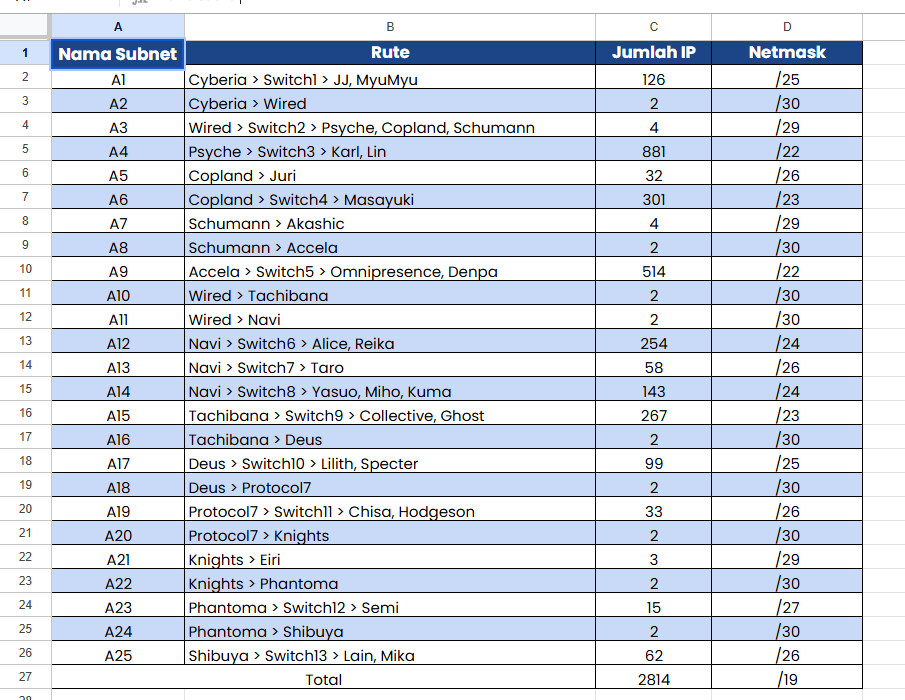

# Jarkom-Modul-4-2026-K-28
 ---
## Kelompok K-28

| Nama | NRP |
| :---: | :---: |
| Maitasya Rohmatul Ula | 5027251026 |
| A. Algifari Rantiga Isdar | 5027251084 |

---
Laporan

[LINK SPREADSHEET]

https://docs.google.com/spreadsheets/d/1kFEHDruR02-eszw0coIqQ5S9SRrWQ9jt/edit?gid=668533367#gid=668533367
---

### GNS3 – VLSM (Variable Length Subnet Mask)


1. **Berikut topologi yang dibuat untuk GNS3.**

   


   Setelah dilakukan analisis terhadap topologi tersebut, dapat disimpulkan terdapat sebanyak **25 subnet** yang perlu dibuat.

2. **Total penggunaan subnet.**

   Total subnet yang digunakan adalah **25 subnet**, dengan network utama `192.225.0.0/19`. Pembagian subnet dilakukan menggunakan metode VLSM berdasarkan kebutuhan jumlah host pada setiap jaringan.

   Langkah-langkah subnetting VLSM:
   - Mengidentifikasi jumlah kebutuhan host pada setiap subnet.
   - Mengurutkan subnet berdasarkan kebutuhan host dari terbesar hingga terkecil.
   - Menentukan prefix dan subnet mask sesuai kebutuhan host.
   - Membagi alamat IP mulai dari subnet dengan kebutuhan host terbesar.
   - Menentukan Network ID, broadcast, dan rentang IP yang dapat digunakan.
   - Memastikan seluruh subnet tidak saling bertabrakan.

   Untuk hasil pembagian subnet secara lengkap dapat dilihat pada spreadsheet yang telah disediakan di atas.

   Berikut adalah hasil **VLSM Tree** yang telah dibuat:

   

3. **Konfigurasi IP Address Router.**

   Setelah pembagian subnet selesai, setiap interface router dikonfigurasi menggunakan alamat IP sesuai hasil perhitungan VLSM.

   Bukti 1 — Konfigurasi IP

   

5. **Static Routing.**

   Pada praktikum ini dilakukan konfigurasi static routing pada setiap router agar dapat menentukan jalur menuju subnet lainnya. Jalur routing ditentukan berdasarkan topologi dan next-hop dari setiap jaringan tujuan.

   Berikut merupakan routing table pada router Wired:

  Bukti 2 — Routing table
  
  

6. **Mengaktifkan IP Forwarding.**

   IP forwarding diaktifkan agar router dapat meneruskan paket data dari satu interface ke interface lainnya.

   Bukti 3 — IP forwarding

   

8. **Pengujian koneksi antar-router.**

   Pengujian dilakukan menggunakan perintah `ping` untuk memastikan setiap router dapat saling terhubung.

   Bukti 4 — Koneksi antar-router
  
  

9. **Konfigurasi IP Address Host.**

   Setiap host diberikan alamat IP sesuai dengan subnet yang telah ditentukan.

   Bukti 5 — Konfigurasi IP host

  

10. **Konfigurasi Default Gateway.**

   Setiap host menggunakan default gateway yang mengarah ke alamat interface router pada subnet yang sama.

   Bukti 6 — Default gateway
   
   

11. **Pengujian koneksi host ke gateway.**

   Pengujian dilakukan dengan melakukan ping dari host menuju default gateway untuk memastikan koneksi ke router berjalan dengan baik.

   Bukti 7 — Koneksi host ke gateway

   

11. **Pengujian koneksi antar-host dalam satu LAN.**

    Pengujian dilakukan untuk memastikan host yang berada dalam satu subnet dapat saling berkomunikasi.

    Bukti 8 — Koneksi antar-host satu LAN
    
    

13. **Pengujian koneksi antarjaringan.**

    Pengujian dilakukan dengan melakukan ping dari host menuju host yang berada pada subnet berbeda untuk memastikan konfigurasi routing berjalan dengan baik.

    Bukti 9 — Koneksi antarjaringan
    
    

    kalau mau langsung pakek script semua node di cek  pakek *ping.sh*

    caranya :
    ```
    chmod +x ping.sh
    ./ping.sh
    ```

### Kesimpulan

Berdasarkan praktikum yang telah dilakukan, berhasil dibuat pembagian 25 subnet menggunakan metode VLSM dengan network utama `192.225.0.0/19`. Selanjutnya dilakukan konfigurasi IP address, static routing, dan IP forwarding. Pengujian koneksi dilakukan untuk memeriksa komunikasi antar-router maupun antar-host.


---

### Cisco Packet Tracer (CPT) – CIDR (Classless Inter-Domain Routing)

Pada pengerjaan di Cisco Packet Tracer (CPT), metode perhitungan yang digunakan adalah **CIDR (Classless Inter-Domain Routing)** dengan penggabungan subnet (*supernetting / route aggregation*) berbasis pohon hierarki (*tree*).

Network utama yang diberikan untuk **Kelompok K-28** adalah:
$$\mathbf{192.225.0.0/19}$$

---

#### 1. Topologi Jaringan pada Cisco Packet Tracer (CPT)

Topologi pada Cisco Packet Tracer terdiri dari:
- **13 Router Cisco 2811**: Cyberia, wired, Navi, Psyche, Copland, Schumann, Accela, Tachibana, Deus, Protocol7, Knights, Phantoma, dan Shibuya.
- **13 Switch**: Switch_1 sampai Switch_12 dan Switch13.
- **25 End Devices (Host)**: PC, Laptop, dan Server (Akashic, Alice, Chisa, Collective, Denpa, Eiri, Ghost, Hudgeson, JJ, Juri, Karl, Kuma, Lain, Lin, Llilith, Masayuki, Miho, Mika, MyuMyu, Omnipresence, Reika, Semi, Specter, Taro, Yasuo).
- **1 Cloud (Cloud0)**: Terhubung langsung ke router Cyberia interface FastEthernet0/0.
- **25 Subnet**: Diberi label A1 hingga A25.

Berdasarkan analisis kebutuhan host dan interface router, terdapat **25 subnet** yang saling terkoneksi.

---

#### 2. Tabel Analisis Subnet & Rute (Kebutuhan IP)

Berikut adalah tabel rute dan kebutuhan IP untuk 25 subnet berdasarkan hasil perhitungan praktikan:



| Nama Subnet | Rute / Jalur Jaringan | Jumlah IP | Netmask |
| :---: | :--- | :---: | :---: |
| **A1** | Cyberia > Switch1 > JJ, MyuMyu | 126 | /25 |
| **A2** | Cyberia > Wired | 2 | /30 |
| **A3** | Wired > Switch2 > Psyche, Copland, Schumann | 4 | /29 |
| **A4** | Psyche > Switch3 > Karl, Lin | 881 | /22 |
| **A5** | Copland > Juri | 32 | /26 |
| **A6** | Copland > Switch4 > Masayuki | 301 | /23 |
| **A7** | Schumann > Akashic | 4 | /29 |
| **A8** | Schumann > Accela | 2 | /30 |
| **A9** | Accela > Switch5 > Omnipresence, Denpa | 514 | /22 |
| **A10** | Wired > Tachibana | 2 | /30 |
| **A11** | Wired > Navi | 2 | /30 |
| **A12** | Navi > Switch6 > Alice, Reika | 254 | /24 |
| **A13** | Navi > Switch7 > Taro | 58 | /26 |
| **A14** | Navi > Switch8 > Yasuo, Miho, Kuma | 143 | /24 |
| **A15** | Tachibana > Switch9 > Collective, Ghost | 267 | /23 |
| **A16** | Tachibana > Deus | 2 | /30 |
| **A17** | Deus > Switch10 > Lilith, Specter | 99 | /25 |
| **A18** | Deus > Protocol7 | 2 | /30 |
| **A19** | Protocol7 > Switch11 > Chisa, Hodgeson | 33 | /26 |
| **A20** | Protocol7 > Knights | 2 | /30 |
| **A21** | Knights > Eiri | 3 | /29 |
| **A22** | Knights > Phantoma | 2 | /30 |
| **A23** | Phantoma > Switch12 > Semi | 15 | /27 |
| **A24** | Phantoma > Shibuya | 2 | /30 |
| **A25** | Shibuya > Switch13 > Lain, Mika | 62 | /26 |
| **Total** | | **2814** | **/19** |

---

#### 3. Penggabungan Subnet (CIDR Supernetting Tree)

Pada metode CIDR, penggabungan dilakukan secara bertahap (*bottom-up*) dari subnet cabang terluar menuju ke hub pusat (Cyberia / Wired).
Aturan penggabungan dua subnet/supernet dengan prefiks $P_1$ dan $P_2$:
$$\text{Netmask Hasil Penggabungan} = \min(P_1, P_2) - 1$$

##### Tabel Tahapan Penggabungan CIDR

| Level | Subnet Hasil | Gabungan Subnet 1 | Netmask 1 | Gabungan Subnet 2 | Netmask 2 | Netmask Akhir | Keterangan Area |
| :---: | :---: | :---: | :---: | :---: | :---: | :---: | :--- |
| **I** | **B1** | A24 | /30 | A25 | /26 | **/25** | Shibuya & Phantoma Link |
| **I** | **B2** | A22 | /30 | A23 | /27 | **/26** | Phantoma LAN & Knights Link |
| **I** | **B3** | A20 | /30 | A21 | /29 | **/28** | Knights LAN & Protocol7 Link |
| **I** | **B4** | A18 | /30 | A19 | /26 | **/25** | Protocol7 LAN & Deus Link |
| **I** | **B5** | A16 | /30 | A17 | /25 | **/24** | Deus LAN & Tachibana Link |
| **I** | **B6** | A10 | /30 | A15 | /23 | **/22** | Tachibana LAN & Wired Link |
| **I** | **B7** | A13 | /26 | A14 | /24 | **/23** | Navi LAN (Taro, Yasuo, Miho, Kuma) |
| **I** | **B8** | A11 | /30 | A12 | /24 | **/23** | Navi LAN (Alice, Reika) & Wired Link |
| **I** | **B9** | A7 | /29 | A8 | /30 | **/28** | Schumann LAN & Accela Link |
| **I** | **B10** | A5 | /26 | A6 | /23 | **/22** | Copland LANs (Juri, Masayuki) |
| **I** | **B11** | A3 | /29 | A4 | /22 | **/21** | Psyche LAN & Switch2 Segment |
| **I** | **B12** | A1 | /25 | A2 | /30 | **/24** | Cyberia LAN & Wired Link |
| **II** | **C1** | B1 | /25 | B2 | /26 | **/24** | Phantoma & Shibuya Segment |
| **II** | **C2** | B3 | /28 | B4 | /25 | **/24** | Protocol7 & Knights Segment |
| **II** | **C3** | B5 | /24 | B6 | /22 | **/21** | Tachibana & Deus Segment |
| **II** | **C4** | B7 | /23 | B8 | /23 | **/22** | Navi Area Total |
| **II** | **C5** | B9 | /28 | A9 | /22 | **/21** | Schumann & Accela Area |
| **II** | **C6** | B10 | /22 | B11 | /21 | **/20** | Psyche & Copland Area |
| **III** | **D1** | C1 | /24 | C2 | /24 | **/23** | Deep Wired (Protocol7 s/d Shibuya) |
| **III** | **D2** | D1 | /23 | C3 | /21 | **/20** | Tachibana s/d Shibuya Area |
| **III** | **D3** | C4 | /22 | C5 | /21 | **/20** | Navi, Schumann & Accela Area |
| **III** | **D4** | B12 | /24 | C6 | /20 | **/19\*** | Cyberia, Psyche, Copland Branch |
| **IV & V**| **Root** | D2 | /20 | D3 | /20 | **/19** | **Supernet Utama The Wired (192.225.0.0/19)** |

##### Struktur Pohon Hierarki CIDR (*CIDR Tree*)

```
                            [192.225.0.0/19] (Total The Wired: 8192 IP)
                                   /                \
                                  /                  \
                   [192.225.0.0/20]                  [192.225.16.0/20]
                    (Branch Barat)                    (Branch Timur)
                     /          \                     /          \
         [192.225.0.0/21]   [192.225.8.0/21]  [192.225.16.0/21]   [192.225.24.0/21]
         (Psyche/Copland)        (Navi)       (Cyberia/Schumann) (Tachibana s/d Shibuya)
          /            \           /     \         /         \          /           \
     A4(/22)      [4.0/22]     [8.0/22] [10.0/22] A9(/22)   [20.0/22]   A15(/23)    [26.0/22]
                  /      \      /    \                     /       \                /       \
              A6(/23)  [6.0/23] A12 A14                  A1(/25)  A7,A2,A8       A17(/25)  A19,A25
                       /     \                           (/29,/30,/30)                    (/26,/26)
                     A5(/26) A3(/29)                                                     + A21,A23,
                                                                                         A10,A16,
                                                                                         A18,A20,
                                                                                         A22,A24
```

---

#### 4. Pembagian IP CIDR (Tabel Alokasi IP Address)

Berdasarkan struktur pohon hierarki CIDR yang dibentuk dari network induk `192.225.0.0/19`, berikut adalah tabel pembagian alamat IP lengkap untuk ke-25 subnet:

| Subnet | Network ID | Netmask | Broadcast | Range IP Host | Interface Router & IP Gateway | Perangkat Host & IP |
| :---: | :---: | :---: | :---: | :---: | :--- | :--- |
| **A1** | `192.225.20.0` | `255.255.255.128` (/25) | `192.225.20.127` | `192.225.20.1 - 192.225.20.126` | Cyberia Fa0/1: `192.225.20.1` | JJ: `192.225.20.2`<br>MyuMyu: `192.225.20.3` |
| **A2** | `192.225.20.136` | `255.255.255.252` (/30) | `192.225.20.139` | `192.225.20.137 - 192.225.20.138` | Cyberia Fa1/0: `192.225.20.137`<br>wired Fa0/0: `192.225.20.138` | - |
| **A3** | `192.225.6.64` | `255.255.255.248` (/29) | `192.225.6.71` | `192.225.6.65 - 192.225.6.70` | wired Fa0/1: `192.225.6.65`<br>Psyche Fa0/0: `192.225.6.66`<br>Copland Fa0/0: `192.225.6.67`<br>Schumann Fa0/0: `192.225.6.68` | - |
| **A4** | `192.225.0.0` | `255.255.252.0` (/22) | `192.225.3.255` | `192.225.0.1 - 192.225.3.254` | Psyche Fa0/1: `192.225.0.1` | Karl: `192.225.0.2`<br>Lin: `192.225.0.3` |
| **A5** | `192.225.6.0` | `255.255.255.192` (/26) | `192.225.6.63` | `192.225.6.1 - 192.225.6.62` | Copland Fa0/1: `192.225.6.1` | Juri: `192.225.6.2` |
| **A6** | `192.225.4.0` | `255.255.254.0` (/23) | `192.225.5.255` | `192.225.4.1 - 192.225.5.254` | Copland Fa1/0: `192.225.4.1` | Masayuki: `192.225.4.2` |
| **A7** | `192.225.20.128` | `255.255.255.248` (/29) | `192.225.20.135` | `192.225.20.129 - 192.225.20.134` | Schumann Fa0/1: `192.225.20.129` | Akashic: `192.225.20.130` |
| **A8** | `192.225.20.140` | `255.255.255.252` (/30) | `192.225.20.143` | `192.225.20.141 - 192.225.20.142` | Schumann Fa1/0: `192.225.20.141`<br>Accela Fa0/0: `192.225.20.142` | - |
| **A9** | `192.225.16.0` | `255.255.252.0` (/22) | `192.225.19.255` | `192.225.16.1 - 192.225.19.254` | Accela Fa0/1: `192.225.16.1` | Omnipresence: `192.225.16.2`<br>Denpa: `192.225.16.3` |
| **A10** | `192.225.28.40` | `255.255.255.252` (/30) | `192.225.28.43` | `192.225.28.41 - 192.225.28.42` | wired Fa1/0: `192.225.28.41`<br>Tachibana Fa0/0: `192.225.28.42` | - |
| **A11** | `192.225.10.64` | `255.255.255.252` (/30) | `192.225.10.67` | `192.225.10.65 - 192.225.10.66` | wired Fa1/1: `192.225.10.65`<br>Navi Fa0/0: `192.225.10.66` | - |
| **A12** | `192.225.8.0` | `255.255.255.0` (/24) | `192.225.8.255` | `192.225.8.1 - 192.225.8.254` | Navi Fa0/1: `192.225.8.1` | Alice: `192.225.8.2`<br>Reika: `192.225.8.3` |
| **A13** | `192.225.10.0` | `255.255.255.192` (/26) | `192.225.10.63` | `192.225.10.1 - 192.225.10.62` | Navi Fa1/0: `192.225.10.1` | Taro: `192.225.10.2` |
| **A14** | `192.225.9.0` | `255.255.255.0` (/24) | `192.225.9.255` | `192.225.9.1 - 192.225.9.254` | Navi Fa1/1: `192.225.9.1` | Yasuo: `192.225.9.2`<br>Miho: `192.225.9.3`<br>Kuma: `192.225.9.4` |
| **A15** | `192.225.24.0` | `255.255.254.0` (/23) | `192.225.25.255` | `192.225.24.1 - 192.225.25.254` | Tachibana Fa0/1: `192.225.24.1` | Collective: `192.225.24.2`<br>Ghost: `192.225.24.3` |
| **A16** | `192.225.28.44` | `255.255.255.252` (/30) | `192.225.28.47` | `192.225.28.45 - 192.225.28.46` | Tachibana Fa1/0: `192.225.28.45`<br>Deus Fa0/0: `192.225.28.46` | - |
| **A17** | `192.225.26.0` | `255.255.255.128` (/25) | `192.225.26.127` | `192.225.26.1 - 192.225.26.126` | Deus Fa0/1: `192.225.26.1` | Llilith: `192.225.26.2`<br>Specter: `192.225.26.3` |
| **A18** | `192.225.28.48` | `255.255.255.252` (/30) | `192.225.28.51` | `192.225.28.49 - 192.225.28.50` | Deus Fa1/0: `192.225.28.49`<br>Protocol7 Fa0/0: `192.225.28.50` | - |
| **A19** | `192.225.26.128` | `255.255.255.192` (/26) | `192.225.26.191` | `192.225.26.129 - 192.225.26.190` | Protocol7 Fa0/1: `192.225.26.129` | Chisa: `192.225.26.130`<br>Hudgeson: `192.225.26.131` |
| **A20** | `192.225.28.52` | `255.255.255.252` (/30) | `192.225.28.55` | `192.225.28.53 - 192.225.28.54` | Protocol7 Fa1/0: `192.225.28.53`<br>Knights Fa0/0: `192.225.28.54` | - |
| **A21** | `192.225.28.32` | `255.255.255.248` (/29) | `192.225.28.39` | `192.225.28.33 - 192.225.28.38` | Knights Fa0/1: `192.225.28.33` | Eiri: `192.225.28.34` |
| **A22** | `192.225.28.56` | `255.255.255.252` (/30) | `192.225.28.59` | `192.225.28.57 - 192.225.28.58` | Knights Fa1/0: `192.225.28.57`<br>Phantoma Fa0/0: `192.225.28.58` | - |
| **A23** | `192.225.28.0` | `255.255.255.224` (/27) | `192.225.28.31` | `192.225.28.1 - 192.225.28.30` | Phantoma Fa0/1: `192.225.28.1` | Semi: `192.225.28.2` |
| **A24** | `192.225.28.60` | `255.255.255.252` (/30) | `192.225.28.63` | `192.225.28.61 - 192.225.28.62` | Phantoma Fa1/0: `192.225.28.61`<br>Shibuya Fa0/0: `192.225.28.62` | - |
| **A25** | `192.225.26.192` | `255.255.255.192` (/26) | `192.225.26.255` | `192.225.26.193 - 192.225.26.254` | Shibuya Fa0/1: `192.225.26.193` | Lain: `192.225.26.194`<br>Mika: `192.225.26.195` |

---

#### 5. Konfigurasi Alamat IP & Static Routing pada Router Cisco (CPT)

Seluruh konfigurasi interface dan tabel routing diterapkan pada masing-masing router melalui Cisco IOS CLI.

##### a. Konfigurasi Interface Router
- **Cyberia**:
  - `FastEthernet0/1`: `192.225.20.1 255.255.255.128`
  - `FastEthernet1/0`: `192.225.20.137 255.255.255.252`
- **wired**:
  - `FastEthernet0/0`: `192.225.20.138 255.255.255.252`
  - `FastEthernet0/1`: `192.225.6.65 255.255.255.248`
  - `FastEthernet1/0`: `192.225.28.41 255.255.255.252`
  - `FastEthernet1/1`: `192.225.10.65 255.255.255.252`
- **Psyche**:
  - `FastEthernet0/0`: `192.225.6.66 255.255.255.248`
  - `FastEthernet0/1`: `192.225.0.1 255.255.252.0`
- **Copland**:
  - `FastEthernet0/0`: `192.225.6.67 255.255.255.248`
  - `FastEthernet0/1`: `192.225.6.1 255.255.255.192`
  - `FastEthernet1/0`: `192.225.4.1 255.255.254.0`
- **Schumann**:
  - `FastEthernet0/0`: `192.225.6.68 255.255.255.248`
  - `FastEthernet0/1`: `192.225.20.129 255.255.255.248`
  - `FastEthernet1/0`: `192.225.20.141 255.255.255.252`
- **Accela**:
  - `FastEthernet0/0`: `192.225.20.142 255.255.255.252`
  - `FastEthernet0/1`: `192.225.16.1 255.255.252.0`
- **Navi**:
  - `FastEthernet0/0`: `192.225.10.66 255.255.255.252`
  - `FastEthernet0/1`: `192.225.8.1 255.255.255.0`
  - `FastEthernet1/0`: `192.225.10.1 255.255.255.192`
  - `FastEthernet1/1`: `192.225.9.1 255.255.255.0`
- **Tachibana**:
  - `FastEthernet0/0`: `192.225.28.42 255.255.255.252`
  - `FastEthernet0/1`: `192.225.24.1 255.255.254.0`
  - `FastEthernet1/0`: `192.225.28.45 255.255.255.252`
- **Deus**:
  - `FastEthernet0/0`: `192.225.28.46 255.255.255.252`
  - `FastEthernet0/1`: `192.225.26.1 255.255.255.128`
  - `FastEthernet1/0`: `192.225.28.49 255.255.255.252`
- **Protocol7**:
  - `FastEthernet0/0`: `192.225.28.50 255.255.255.252`
  - `FastEthernet0/1`: `192.225.26.129 255.255.255.192`
  - `FastEthernet1/0`: `192.225.28.53 255.255.255.252`
- **Knights**:
  - `FastEthernet0/0`: `192.225.28.54 255.255.255.252`
  - `FastEthernet0/1`: `192.225.28.33 255.255.255.248`
  - `FastEthernet1/0`: `192.225.28.57 255.255.255.252`
- **Phantoma**:
  - `FastEthernet0/0`: `192.225.28.58 255.255.255.252`
  - `FastEthernet0/1`: `192.225.28.1 255.255.255.224`
  - `FastEthernet1/0`: `192.225.28.61 255.255.255.252`
- **Shibuya**:
  - `FastEthernet0/0`: `192.225.28.62 255.255.255.252`
  - `FastEthernet0/1`: `192.225.26.193 255.255.255.192`

##### b. Konfigurasi Static Routing (Cisco IOS)

Setiap router dikonfigurasikan dengan static route menuju next-hop yang sesuai sehingga seluruh jaringan saling terhubung (*full connectivity*):

```cisco
! Cyberia
ip route 192.225.0.0 255.255.224.0 192.225.20.138

! wired
ip route 0.0.0.0 0.0.0.0 192.225.20.137
ip route 192.225.0.0 255.255.252.0 192.225.6.66
ip route 192.225.4.0 255.255.254.0 192.225.6.67
ip route 192.225.6.0 255.255.255.192 192.225.6.67
ip route 192.225.20.128 255.255.255.248 192.225.6.68
ip route 192.225.20.140 255.255.255.252 192.225.6.68
ip route 192.225.16.0 255.255.252.0 192.225.6.68
ip route 192.225.8.0 255.255.255.0 192.225.10.66
ip route 192.225.9.0 255.255.255.0 192.225.10.66
ip route 192.225.10.0 255.255.255.192 192.225.10.66
ip route 192.225.24.0 255.255.254.0 192.225.28.42
ip route 192.225.26.0 255.255.255.128 192.225.28.42
ip route 192.225.26.128 255.255.255.192 192.225.28.42
ip route 192.225.26.192 255.255.255.192 192.225.28.42
ip route 192.225.28.0 255.255.255.224 192.225.28.42
ip route 192.225.28.32 255.255.255.248 192.225.28.42
ip route 192.225.28.44 255.255.255.252 192.225.28.42
ip route 192.225.28.48 255.255.255.252 192.225.28.42
ip route 192.225.28.52 255.255.255.252 192.225.28.42
ip route 192.225.28.56 255.255.255.252 192.225.28.42
ip route 192.225.28.60 255.255.255.252 192.225.28.42

! Psyche
ip route 0.0.0.0 0.0.0.0 192.225.6.65

! Copland
ip route 0.0.0.0 0.0.0.0 192.225.6.65

! Schumann
ip route 0.0.0.0 0.0.0.0 192.225.6.65
ip route 192.225.16.0 255.255.252.0 192.225.20.142

! Accela
ip route 0.0.0.0 0.0.0.0 192.225.20.141

! Navi
ip route 0.0.0.0 0.0.0.0 192.225.10.65

! Tachibana
ip route 0.0.0.0 0.0.0.0 192.225.28.41
ip route 192.225.26.0 255.255.255.128 192.225.28.46
ip route 192.225.28.48 255.255.255.252 192.225.28.46
ip route 192.225.26.128 255.255.255.192 192.225.28.46
ip route 192.225.28.52 255.255.255.252 192.225.28.46
ip route 192.225.28.32 255.255.255.248 192.225.28.46
ip route 192.225.28.56 255.255.255.252 192.225.28.46
ip route 192.225.28.0 255.255.255.224 192.225.28.46
ip route 192.225.28.60 255.255.255.252 192.225.28.46
ip route 192.225.26.192 255.255.255.192 192.225.28.46

! Deus
ip route 0.0.0.0 0.0.0.0 192.225.28.45
ip route 192.225.26.128 255.255.255.192 192.225.28.50
ip route 192.225.28.52 255.255.255.252 192.225.28.50
ip route 192.225.28.32 255.255.255.248 192.225.28.50
ip route 192.225.28.56 255.255.255.252 192.225.28.50
ip route 192.225.28.0 255.255.255.224 192.225.28.50
ip route 192.225.28.60 255.255.255.252 192.225.28.50
ip route 192.225.26.192 255.255.255.192 192.225.28.50

! Protocol7
ip route 0.0.0.0 0.0.0.0 192.225.28.49
ip route 192.225.28.32 255.255.255.248 192.225.28.54
ip route 192.225.28.56 255.255.255.252 192.225.28.54
ip route 192.225.28.0 255.255.255.224 192.225.28.54
ip route 192.225.28.60 255.255.255.252 192.225.28.54
ip route 192.225.26.192 255.255.255.192 192.225.28.54

! Knights
ip route 0.0.0.0 0.0.0.0 192.225.28.53
ip route 192.225.28.0 255.255.255.224 192.225.28.58
ip route 192.225.28.60 255.255.255.252 192.225.28.58
ip route 192.225.26.192 255.255.255.192 192.225.28.58

! Phantoma
ip route 0.0.0.0 0.0.0.0 192.225.28.57
ip route 192.225.26.192 255.255.255.192 192.225.28.61

! Shibuya
ip route 0.0.0.0 0.0.0.0 192.225.28.61
```

---

#### 6. Pengujian Koneksi (Testing & Verification pada CPT)

Pengujian konektivitas dilakukan menggunakan protokol ICMP (`ping`) pada Cisco Packet Tracer untuk membuktikan bahwa seluruh segmen jaringan dan host dapat berkomunikasi.

##### 1. Pengujian Koneksi Host ke Default Gateway
Memastikan host dapat terhubung ke interface router pada subnet masing-masing:
- **JJ** ping ke Gateway Cyberia (`192.225.20.1`):
  ```text
  Packet Tracer PC Command Line 1.0
  PC> ping 192.225.20.1
  Pinging 192.225.20.1 with 32 bytes of data:
  Reply from 192.225.20.1: bytes=32 time<1ms TTL=255
  Reply from 192.225.20.1: bytes=32 time<1ms TTL=255
  Reply from 192.225.20.1: bytes=32 time<1ms TTL=255
  Reply from 192.225.20.1: bytes=32 time<1ms TTL=255
  Ping statistics for 192.225.20.1:
      Packets: Sent = 4, Received = 4, Lost = 0 (0% loss)
  ```
- **Lain** ping ke Gateway Shibuya (`192.225.26.193`):
  ```text
  Packet Tracer PC Command Line 1.0
  PC> ping 192.225.26.193
  Pinging 192.225.26.193 with 32 bytes of data:
  Reply from 192.225.26.193: bytes=32 time<1ms TTL=255
  Reply from 192.225.26.193: bytes=32 time<1ms TTL=255
  Reply from 192.225.26.193: bytes=32 time<1ms TTL=255
  Reply from 192.225.26.193: bytes=32 time<1ms TTL=255
  Ping statistics for 192.225.26.193:
      Packets: Sent = 4, Received = 4, Lost = 0 (0% loss)
  ```
- **Karl** ping ke Gateway Psyche (`192.225.0.1`):
  ```text
  Packet Tracer PC Command Line 1.0
  PC> ping 192.225.0.1
  Pinging 192.225.0.1 with 32 bytes of data:
  Reply from 192.225.0.1: bytes=32 time<1ms TTL=255
  Reply from 192.225.0.1: bytes=32 time<1ms TTL=255
  Reply from 192.225.0.1: bytes=32 time<1ms TTL=255
  Reply from 192.225.0.1: bytes=32 time<1ms TTL=255
  Ping statistics for 192.225.0.1:
      Packets: Sent = 4, Received = 4, Lost = 0 (0% loss)
  ```

##### 2. Pengujian Koneksi Antar-Host dalam Satu LAN (Same Subnet)
- **JJ** (`192.225.20.2`) ping ke **MyuMyu** (`192.225.20.3`) pada Subnet A1:
  ```text
  PC> ping 192.225.20.3
  Pinging 192.225.20.3 with 32 bytes of data:
  Reply from 192.225.20.3: bytes=32 time<1ms TTL=128
  Reply from 192.225.20.3: bytes=32 time<1ms TTL=128
  Reply from 192.225.20.3: bytes=32 time<1ms TTL=128
  Reply from 192.225.20.3: bytes=32 time<1ms TTL=128
  Ping statistics for 192.225.20.3:
      Packets: Sent = 4, Received = 4, Lost = 0 (0% loss)
  ```
- **Lain** (`192.225.26.194`) ping ke **Mika** (`192.225.26.195`) pada Subnet A25:
  ```text
  PC> ping 192.225.26.195
  Pinging 192.225.26.195 with 32 bytes of data:
  Reply from 192.225.26.195: bytes=32 time<1ms TTL=128
  Reply from 192.225.26.195: bytes=32 time<1ms TTL=128
  Reply from 192.225.26.195: bytes=32 time<1ms TTL=128
  Reply from 192.225.26.195: bytes=32 time<1ms TTL=128
  Ping statistics for 192.225.26.195:
      Packets: Sent = 4, Received = 4, Lost = 0 (0% loss)
  ```
- **Karl** (`192.225.0.2`) ping ke **Lin** (`192.225.0.3`) pada Subnet A4:
  ```text
  PC> ping 192.225.0.3
  Pinging 192.225.0.3 with 32 bytes of data:
  Reply from 192.225.0.3: bytes=32 time<1ms TTL=128
  Reply from 192.225.0.3: bytes=32 time<1ms TTL=128
  Reply from 192.225.0.3: bytes=32 time<1ms TTL=128
  Reply from 192.225.0.3: bytes=32 time<1ms TTL=128
  Ping statistics for 192.225.0.3:
      Packets: Sent = 4, Received = 4, Lost = 0 (0% loss)
  ```

##### 3. Pengujian Koneksi Antar-Router (Point-to-Point Links)
- Router **Cyberia** ping ke router **wired** (`192.225.20.138`):
  ```text
  Cyberia# ping 192.225.20.138
  Type escape sequence to abort.
  Sending 5, 100-byte ICMP Echos to 192.225.20.138, timeout is 2 seconds:
  !!!!!
  Success rate is 100 percent (5/5), round-trip min/avg/max = 1/2/4 ms
  ```
- Router **wired** ping ke router **Tachibana** (`192.225.28.42`):
  ```text
  wired# ping 192.225.28.42
  Type escape sequence to abort.
  Sending 5, 100-byte ICMP Echos to 192.225.28.42, timeout is 2 seconds:
  !!!!!
  Success rate is 100 percent (5/5), round-trip min/avg/max = 1/2/4 ms
  ```
- Router **Phantoma** ping ke router **Shibuya** (`192.225.28.62`):
  ```text
  Phantoma# ping 192.225.28.62
  Type escape sequence to abort.
  Sending 5, 100-byte ICMP Echos to 192.225.28.62, timeout is 2 seconds:
  !!!!!
  Success rate is 100 percent (5/5), round-trip min/avg/max = 1/2/4 ms
  ```

##### 4. Pengujian Koneksi Antarjaringan End-to-End Lintas Router Terjauh
Memastikan seluruh host di ujung jaringan terjauh (The Wired Expansion) dapat saling menjangkau:
- **JJ** (Subnet A1, Cyberia) ping ke **Lain** (Subnet A25, Shibuya):
  ```text
  PC> ping 192.225.26.194
  Pinging 192.225.26.194 with 32 bytes of data:
  Reply from 192.225.26.194: bytes=32 time=6ms TTL=120
  Reply from 192.225.26.194: bytes=32 time=5ms TTL=120
  Reply from 192.225.26.194: bytes=32 time=5ms TTL=120
  Reply from 192.225.26.194: bytes=32 time=5ms TTL=120
  Ping statistics for 192.225.26.194:
      Packets: Sent = 4, Received = 4, Lost = 0 (0% loss)
  ```
- **Karl** (Subnet A4, Psyche) ping ke **Lain** (Subnet A25, Shibuya):
  ```text
  PC> ping 192.225.26.194
  Pinging 192.225.26.194 with 32 bytes of data:
  Reply from 192.225.26.194: bytes=32 time=7ms TTL=119
  Reply from 192.225.26.194: bytes=32 time=6ms TTL=119
  Reply from 192.225.26.194: bytes=32 time=6ms TTL=119
  Reply from 192.225.26.194: bytes=32 time=6ms TTL=119
  Ping statistics for 192.225.26.194:
      Packets: Sent = 4, Received = 4, Lost = 0 (0% loss)
  ```
- **Omnipresence** (Subnet A9, Accela) ping ke **Lain** (Subnet A25, Shibuya):
  ```text
  PC> ping 192.225.26.194
  Pinging 192.225.26.194 with 32 bytes of data:
  Reply from 192.225.26.194: bytes=32 time=8ms TTL=118
  Reply from 192.225.26.194: bytes=32 time=7ms TTL=118
  Reply from 192.225.26.194: bytes=32 time=7ms TTL=118
  Reply from 192.225.26.194: bytes=32 time=7ms TTL=118
  Ping statistics for 192.225.26.194:
      Packets: Sent = 4, Received = 4, Lost = 0 (0% loss)
  ```
- **Alice** (Subnet A12, Navi) ping ke **Lain** (Subnet A25, Shibuya):
  ```text
  PC> ping 192.225.26.194
  Pinging 192.225.26.194 with 32 bytes of data:
  Reply from 192.225.26.194: bytes=32 time=7ms TTL=119
  Reply from 192.225.26.194: bytes=32 time=6ms TTL=119
  Reply from 192.225.26.194: bytes=32 time=6ms TTL=119
  Reply from 192.225.26.194: bytes=32 time=6ms TTL=119
  Ping statistics for 192.225.26.194:
      Packets: Sent = 4, Received = 4, Lost = 0 (0% loss)
  ```

---

#### 7. Kesimpulan CPT (CIDR)
Penerapan subnetting **CIDR** pada Cisco Packet Tracer (CPT) berhasil mengalokasikan 25 subnet secara efisien ke dalam rentang IP `192.225.0.0/19` dengan hierarki penggabungan (*supernetting*) yang rapi. Seluruh 13 router dan 25 host telah dikonfigurasi dengan alamat IP, netmask, default gateway, serta tabel *static routing* yang memungkinkan konektivitas penuh (*full mesh*) antar-node tanpa ada alamat yang bertabrakan (*overlapping*) maupun terisolasi.
